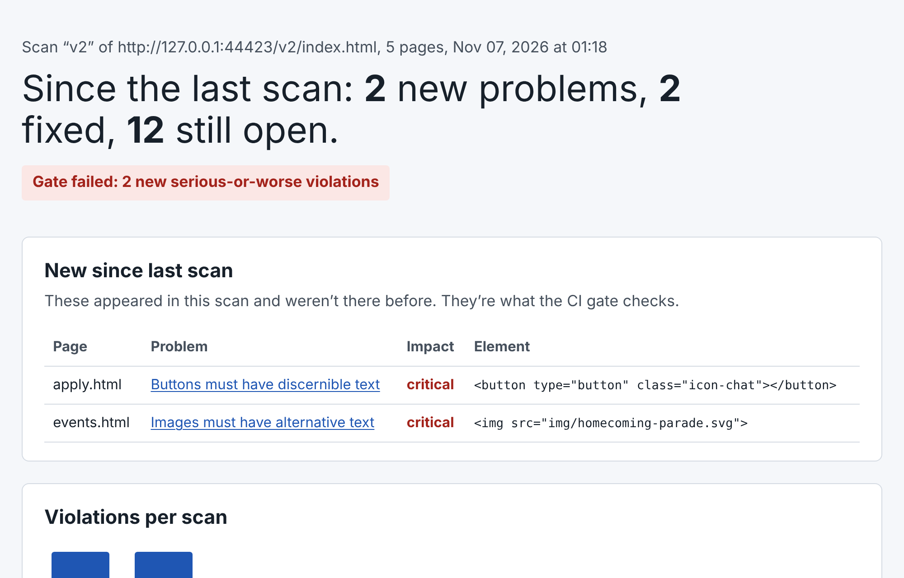
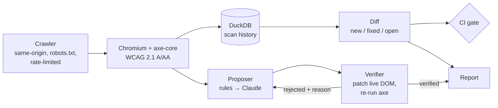

# A11y Sentinel

**Catch accessibility regressions before they ship, and get fixes that are proven to work.**

[](https://github.com/GowthamReddyKotha14/a11y-sentinel/actions/workflows/ci.yml)

**[▶ Try the live demo](https://gowthamreddykotha14.github.io/a11y-sentinel/)**: scan a page and watch fixes get verified, right in your browser.

Public universities must make their websites meet **WCAG 2.1 Level AA** under the DOJ's ADA Title II rule, with the compliance date for large public entities now **April 26, 2027**. A one-time audit doesn't hold: a site that passes in March can fail in May after one content update.

A11y Sentinel treats accessibility like test coverage:

1. **Scan.** Crawls a site in a real browser and runs [axe-core](https://github.com/dequelabs/axe-core) against WCAG 2.1 A/AA on every page.
2. **Track.** Stores every scan in DuckDB and reports what's **new**, **fixed**, and **still open**.
3. **Gate.** A CI check fails a pull request only when it introduces *new* serious violations.
4. **Fix, with proof.** A fix agent (deterministic rules, plus Claude when enabled) proposes patches. Each one is applied to the live page and re-scanned. It counts only if the problem disappears, nothing else breaks, and no content is removed.



## Try it in one command

```bash
pip install -e ".[dev]"
python -m playwright install chromium
sentinel demo            # add --llm with ANTHROPIC_API_KEY set to use Claude
open demo_output/report.html
```

The demo serves a deliberately inaccessible fictional site, **Kestrel State University**, in two versions. v2 fixes two problems and accidentally introduces two new ones, the way real releases do.

```
v1: 14 violations on 5 pages
v2: 14 violations on 5 pages
diff v1 -> v2: {'new': 2, 'fixed': 2, 'open': 12}; gate would FAIL (2 new serious+)
fixes: 11/14 verified
```

The total didn't change, but the gate still fails. That's the point: a stable count can hide regressions.

## Use it on a real site

```bash
sentinel scan https://www.example.edu/admissions/ --max-pages 30 --label oct --json oct.json
sentinel scan https://www.example.edu/admissions/ --max-pages 30 --label nov --json nov.json
sentinel gate nov.json --baseline oct.json            # exit 1 on new serious+ violations
sentinel fix  https://www.example.edu/admissions/apply.html --llm --out fixes.json
sentinel report --fixes fixes.json --out report.html
```

To gate pull requests on a website repo, see [`examples/a11y-gate.yml`](examples/a11y-gate.yml).

## How it works



| Module | Job |
|---|---|
| `sentinel/crawler.py` | Breadth-first crawl, scoped to the start URL's origin and directory; obeys robots.txt; delay between pages |
| `sentinel/scanner.py` | Injects pinned axe-core 4.10.3, normalizes results, assigns stable fingerprints |
| `sentinel/store.py` | DuckDB schema for scans, pages, and violations |
| `sentinel/diff.py` | New/fixed/open comparison and the gate rule |
| `sentinel/fixer.py` | Rule proposer, Claude proposer, verifier, and retry loop |
| `sentinel/report.py` | Self-contained HTML report |

## Design decisions

**1. The LLM is never trusted, only verified.**
A model can "fix" a missing `alt` by replacing the `` with a `<span>`: axe goes quiet and the content is gone. So every proposal goes through a verifier that applies it to the real DOM and re-runs axe on the whole page. It accepts the fix only if:
- the target rule fails on fewer elements,
- no other rule starts failing,
- the element keeps its tag and visible text.

When a fix is rejected, the verifier's reason goes back to the model for one retry. Tests cover each rejection path (`tests/test_fixer.py`).

**2. "Verified" means technically valid, not semantically correct.**
The verifier can prove an image now *has* alt text. It cannot prove the text describes the image. Proposals that need human judgment are flagged `needs_review`, and the report says so.

**3. Gate on regressions, not the backlog.**
A gate that fails on all 300 existing violations gets switched off within a week. Failing only on *new* serious violations ("don't make it worse") is enforceable from day one, while the report tracks backlog burn-down separately.

**4. Fingerprint = page path + rule + selector, deliberately excluding HTML.**
Including HTML would make every copy edit look like a new violation. The trade-off: if a DOM restructure changes a selector, one old violation shows up as "fixed + new." That's noisy, but safe. A gate should over-report, never silently swallow a problem. Paths are taken relative to the scan root, so staging and production fingerprints match.

**5. Cheap deterministic rules first, LLM second.**
Missing `lang`, unlabeled inputs, and icon-only buttons are mechanical. They're fixed by rules in milliseconds, for free, with no API key. The LLM handles what needs judgment, such as color contrast in context.

**6. DuckDB, not a server database.**
This runs on a laptop or in a CI job. An embedded analytical database gives real SQL with zero infrastructure. The schema ports to Postgres or Snowflake unchanged if it becomes a service.

**7. The report passes its own scan.**
`tests/test_report.py` runs axe against the generated report in light and dark mode and fails on any violation.

## Limits and responsible use

- Automated tools detect only part of WCAG. Keyboard flow, reading order, meaningful alt text, and captions still need manual testing. A clean report means "no detectable failures," not "accessible."
- Only scan sites you're allowed to. The crawler stays on one origin, obeys robots.txt, and waits between pages (1 second by default).
- iframes and shadow DOM are scanned but not auto-fixed yet.
- Fixes are proposals for a developer to apply in the source code. The tool never modifies a live site.

## Tests

```bash
pytest -q        # 16 tests: scanner, crawler, diff/gate, verifier, report self-scan
```

## Roadmap

- [ ] Open the fix as a GitHub pull request against the site's source repo
- [ ] Map violations to the shared template that caused them
- [ ] Scheduled weekly scans on AWS (Lambda + S3) with trend history
- [ ] Contrast fixes that respect the site's color tokens

## License

MIT. Bundles axe-core (MPL-2.0) by Deque Systems.
